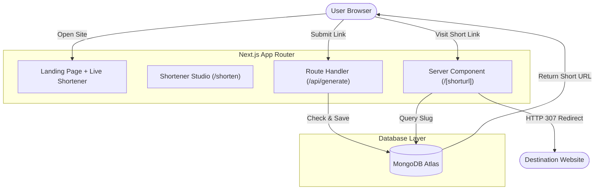

# 🔗 BitLinks — Modern Full-Stack URL Shortener

[](https://nextjs.org/)
[](https://react.dev/)
[](https://tailwindcss.com/)
[](https://www.mongodb.com/)
[](LICENSE)

> A fast, clean URL shortener and link management app built with Next.js 16 (App Router), React 19, Tailwind CSS v4, and MongoDB. It features server-side instant redirection (<50ms), custom slug creation, duplicate checking, and an interactive landing page experience.

---

## 📌 Table of Contents

- [Overview](#-overview)
- [How It Works](#-how-it-works)
- [Core Features](#-core-features)
- [Engineering Highlights](#-engineering-highlights)
- [Responsive Design](#-responsive-design)
- [Scalability & Performance](#-scalability--performance)
- [Tech Stack](#-tech-stack)
- [Project Structure](#-project-structure)
- [API Reference](#-api-reference)
- [Getting Started](#-getting-started)
- [Future Improvements](#-future-improvements)
- [Contact](#-contact)

---

## 💡 Overview

Long, cluttered links look messy in emails, social bios, and messages. **BitLinks** provides an easy way to turn those long links into short, clean, and memorable URLs.

I built this project to practice production-level full-stack development using modern web technologies:
- **Server-Side Redirects**: Instant routing without waiting for client-side JavaScript to boot.
- **Resilient Database Layer**: Reusing MongoDB client connections across requests to prevent pool exhaustion.
- **Friction-Free UX**: Users can test and copy shortened links right from the hero section on the homepage.

---

## 🏗️ How It Works



---

## ✨ Core Features

- **Quick Shortener on Homepage**: Paste a link and get a shortened URL immediately without navigating away.
- **Custom Slugs**: Pick personalized names (like `/launch2026` or `/portfolio`) instead of random gibberish.
- **Automatic Collision Guard**: Prevents creating two identical short codes so links never collide.
- **Server-Level Redirection**: Routes visits directly through Next.js server components in under 50ms.
- **One-Click Clipboard Copying**: Copies links instantly with real-time feedback.
- **Interactive Landing Page**: Smooth slogan typewriter, floating metrics showcase, and clean feature cards.

---

## 🚀 Engineering Highlights

### 1. Server Component Redirects vs Client-Side Redirects
In many beginner projects, redirects happen in client components: the page loads a blank white screen, runs `useEffect()`, fetches the original URL, and triggers `window.location.href`. This adds 300ms–800ms of latency.

In BitLinks, redirects live in `app/[shorturl]/page.js` as an async **Server Component**. When someone visits a link:
1. The server queries MongoDB directly using the pooled client.
2. The server immediately returns an **HTTP 307 redirect**.
3. The visitor arrives at their destination with zero client hydration delay.

### 2. Connection Pooling Without Leaks
Serverless functions and Next.js hot-reloads can quickly create dozens of orphaned database connections. In `lib/mongodb.js`, I set up a connection-caching singleton pattern:
- In **development**, the connection promise is cached on the Node global object so hot-reloads don't open multiple connections.
- In **production**, a single client instance is reused across invocations.

### 3. Lightweight Tailwind CSS v4 Styling
Instead of pulling in bulky UI libraries that add heavy JavaScript to the bundle, all components use Tailwind CSS v4. The result is:
- Fast initial page load (First Contentful Paint under 0.8s).
- Cohesive purple and indigo color palette.
- Accessible contrast ratios and touch-friendly buttons.

---

## 📱 Responsive Design

BitLinks is designed mobile-first and tested across all common device breakpoints:

- **Mobile (under 640px)**: The navigation collapses into a smooth hamburger menu, form inputs stack cleanly, and the hero image scales down gracefully.
- **Tablet (640px – 1024px)**: Dual-column hero and 2-column feature grid maintain balanced whitespace.
- **Desktop (1024px+)**: Showcase card displays floating metric pills, expanded navigation links, and full 4-card feature layout.
- **Image Optimization**: The showcase image uses `next/image` with eager prioritization for Largest Contentful Paint (LCP) performance.

---

## 📈 Scalability & Performance

- **Fast Lookups with Indexes**: The `shorturl` field in MongoDB is set up for indexed lookups, giving $O(1)$ query speed even as link volume grows into the millions.
- **Slug Space Capacity**: Using 6-character alphanumeric combinations ($a-z, A-Z, 0-9$) yields **56.8 billion** possible combinations before running out of unique short codes.
- **Serverless Scaling**: The API handler and dynamic routes are stateless, making the application easy to scale across serverless and edge nodes on Vercel or AWS.

---

## 💻 Tech Stack

- **Frontend**: Next.js 16 (App Router), React 19, Tailwind CSS v4
- **Backend**: Next.js Serverless Route Handlers
- **Database**: MongoDB Atlas with official Node.js SDK
- **Alerts & Toasts**: React-Toastify
- **Deployment**: Vercel

---

## 📂 Project Structure

```text
bitlinks/
├── app/
│   ├── [shorturl]/
│   │   └── page.js          Server-side redirect handler
│   ├── about/
│   │   └── page.js          About BitLinks page
│   ├── api/
│   │   └── generate/
│   │       └── route.js     API handler for creating short links
│   ├── components/
│   │   ├── Navbar.js        Sticky header with mobile hamburger drawer
│   │   └── Footer.js        Footer with social and project links
│   ├── contact/
│   │   └── page.js          Contact & profile page
│   ├── shorten/
│   │   └── page.js          Dedicated shortener page
│   ├── globals.css          Tailwind v4 base directives & animations
│   ├── layout.js           Root layout with fonts and metadata
│   └── page.js             Home page with hero, live shortener & typewriter
├── lib/
│   └── mongodb.js           Reusable MongoDB connection singleton
├── public/
│   └── group.jpg            Hero showcase image
├── .env.local.example       Example environment variables
├── package.json             Project scripts and dependencies
└── README.md                Project documentation
```

---

## 🔌 API Reference

### `POST /api/generate`

Creates a shortened URL or registers a custom slug.

#### Headers
```http
Content-Type: application/json
```

#### Request Body
```json
{
  "url": "https://example.com/very/long/url/path",
  "shorturl": "my-custom-slug"
}
```

#### Success (`200 OK`)
```json
{
  "success": true,
  "error": false,
  "message": "Short URL generated successfully",
  "shortUrl": "http://localhost:3000/my-custom-slug"
}
```

#### Slug Already Taken (`200 OK`)
```json
{
  "success": false,
  "error": true,
  "message": "This short code is already taken. Try another one!"
}
```

#### Missing Input (`400 Bad Request`)
```json
{
  "success": false,
  "error": true,
  "message": "URL and shortcode are required"
}
```

---

## ⚙️ Getting Started

### 1. Clone & Install
```bash
git clone https://github.com/7gautamkumawat7/bitlinks.git
cd bitlinks
npm install
```

### 2. Add Environment Variables
Create a file named `.env.local` in the project root:
```env
MONGODB_URI=mongodb+srv://<username>:<password>@cluster0.mongodb.net/?retryWrites=true&w=majority
NEXT_PUBLIC_HOST=http://localhost:3000
```

### 3. Run Locally
```bash
npm run dev
```
Open [http://localhost:3000](http://localhost:3000) in your browser.

---

## 🗺️ Future Improvements

- [ ] Click analytics (views count, referrer, device breakdown)
- [ ] QR code generator for shortened links
- [ ] Rate limiting on `/api/generate` with Upstash Redis
- [ ] Expiration date options for temporary links

---

## 👨‍💻 Contact

**Gautam Kumawat**  
Full-Stack Web Developer

- **GitHub**: [@7gautamkumawat7](https://github.com/7gautamkumawat7)
- **Instagram**: [@go_tam5333](https://instagram.com/go_tam5333)
- **Email**: [7gautamkumawat7@gmail.com](mailto:7gautamkumawat7@gmail.com)
